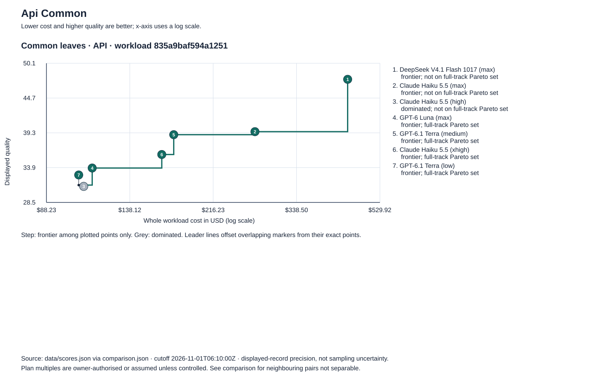
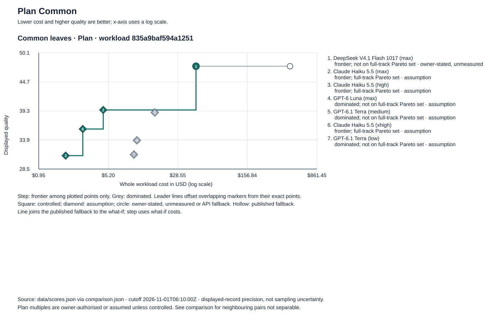
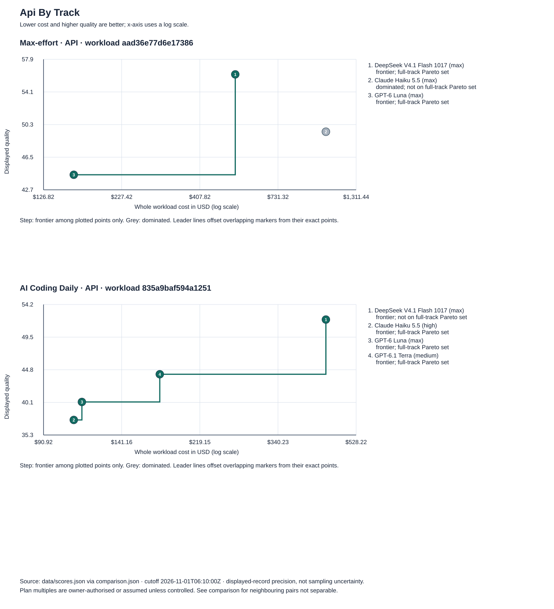

# ValueRank comparison of nine configurations

Release v3.0.0, cutoff 2026-11-01T06:10:00Z. Seven requested efforts are published. The common-leaves ranking is diagnostic only under O121: it earns no interval or scenario label and never holds a release. The OpenCode route below is an unmeasured what-if. [Full source-linked machine-readable data](comparison.json) and [evidence notes](evidence-notes.md) retain exact precision and provenance.

DeepSeek leads the selected seven on common-track API value; Haiku Max leads their published Plan values. The OpenCode Go what-if improves DeepSeek’s Plan position. The Plan ranking is exploratory because multiples for the target workload are unidentified. Ordering by point value does not establish pairwise separability.

## Configuration identity

| Configuration | Main | AI Coding Daily | Common diagnostic |
|---|---|---|---|
| Claude Haiku 5.5 (xhigh) | — | — | claude-haiku-5-5; xhigh |
| Claude Haiku 5.5 (high) | — | claude-haiku-5-5-high; high | claude-haiku-5-5-high; high |
| Claude Haiku 5.5 (max) | claude-haiku-5-5-max; max | — | claude-haiku-5-5-max; max |
| DeepSeek V4.1 Flash 1017 | deepseek-v4-1-flash-1017; max | deepseek-v4-1-flash-1017; max | deepseek-v4-1-flash-1017; max |
| GPT-6 Luna (max) | gpt-6-luna; max | gpt-6-luna; max | gpt-6-luna; max |
| GPT-6.1 Terra (low) | — | — | gpt-6.1-terra-low; low |
| GPT-6.1 Terra (medium) | — | gpt-6.1-terra-medium; medium | gpt-6.1-terra-medium; medium |
| Sonnet 5.5 Medium | — | — | — |
| Opus 5.5 Low | — | — | — |

The unlabelled Sonnet row is Max, corroborated by its effort field, AA mapping, configuration map and AA snapshot; it is not Medium.

## Published track results

Quality bounds describe precision of the published record, not sampling confidence intervals. All selected rows have 100% coverage, status scored, and no provisional reasons. Cost is the whole workload in USD; ranks are across each full track and basis.

### main — workload aad36e77d6e17386

| Configuration | Quality [lower, upper] | API cost / cost score / value / rank | Selected Plan route / multiple / grade | Plan cost / cost score / value / rank |
|---|---:|---|---|---|
| DeepSeek V4.1 Flash 1017 | 56.140 [56.137, 56.143] | 531.436 / 65.932 / 58.588 / 2 | API fallback / — / fallback | 531.436 / 35.300 / 50.930 / 22 |
| Claude Haiku 5.5 (max) | 49.441 [49.438, 49.444] | 1046.080 / 53.788 / 50.528 / 7 | claude-pro-claude-haiku-5-5-max-common-opus55-assumption / 58.900 / assumption | 17.760 / 100.000 / 62.081 / 11 |
| GPT-6 Luna (max) | 44.415 [44.412, 44.418] | 158.991 / 87.571 / 55.204 / 4 | chatgpt-pro500-gpt-6-luna-common-gpt-assumption / 10.772 / assumption | 14.760 / 100.000 / 58.311 / 17 |

### aicd — workload 835a9baf594a1251

| Configuration | Quality [lower, upper] | API cost / cost score / value / rank | Selected Plan route / multiple / grade | Plan cost / cost score / value / rank |
|---|---:|---|---|---|
| DeepSeek V4.1 Flash 1017 | 52.052 [52.047, 52.057] | 445.516 / 50.063 / 51.555 / 4 | API fallback / — / fallback | 445.516 / 10.717 / 41.718 / 62 |
| Claude Haiku 5.5 (high) | 37.514 [37.509, 37.519] | 107.798 / 72.245 / 46.197 / 15 | claude-pro-claude-haiku-5-5-high-common-opus55-assumption / 58.900 / assumption | 1.830 / 100.000 / 53.135 / 39 |
| GPT-6 Luna (max) | 40.118 [40.113, 40.123] | 112.836 / 71.531 / 47.971 / 14 | chatgpt-pro500-gpt-6-luna-common-gpt-assumption / 10.772 / assumption | 10.475 / 99.724 / 55.020 / 28 |
| GPT-6.1 Terra (medium) | 44.131 [44.127, 44.136] | 174.911 / 64.679 / 49.268 / 9 | chatgpt-pro500-gpt-6.1-terra-medium-common-gpt-assumption / 10.772 / assumption | 16.238 / 89.321 / 55.429 / 25 |

### common — workload 835a9baf594a1251

| Configuration | Quality [lower, upper] | API cost / cost score / value / rank | Selected Plan route / multiple / grade | Plan cost / cost score / value / rank |
|---|---:|---|---|---|
| DeepSeek V4.1 Flash 1017 | 47.626 [47.620, 47.633] | 445.516 / 41.842 / 46.180 / 10 | API fallback / — / fallback | 445.516 / 20.528 / 40.852 / 96 |
| Claude Haiku 5.5 (max) | 39.493 [39.487, 39.499] | 270.654 / 47.983 / 41.616 / 21 | claude-pro-claude-haiku-5-5-max-common-opus55-assumption / 58.900 / assumption | 4.595 / 100.000 / 54.620 / 39 |
| Claude Haiku 5.5 (high) | 30.992 [30.986, 30.998] | 107.798 / 59.327 / 38.076 / 27 | claude-pro-claude-haiku-5-5-high-common-opus55-assumption / 58.900 / assumption | 1.830 / 100.000 / 48.244 / 80 |
| GPT-6 Luna (max) | 33.845 [33.838, 33.851] | 112.836 / 58.764 / 40.075 / 25 | chatgpt-pro500-gpt-6-luna-common-gpt-assumption / 10.772 / assumption | 10.475 / 99.754 / 50.322 / 71 |
| GPT-6.1 Terra (medium) | 39.024 [39.018, 39.030] | 174.911 / 53.363 / 42.609 / 19 | chatgpt-pro500-gpt-6.1-terra-medium-common-gpt-assumption / 10.772 / assumption | 16.238 / 90.494 / 51.892 / 57 |
| Claude Haiku 5.5 (xhigh) | 35.943 [35.937, 35.949] | 164.014 / 54.156 / 40.496 / 24 | claude-pro-claude-haiku-5-5-common-opus55-assumption / 58.900 / assumption | 2.785 / 100.000 / 51.957 / 54 |
| GPT-6.1 Terra (low) | 31.191 [31.185, 31.197] | 104.945 / 59.658 / 38.308 / 26 | chatgpt-pro500-gpt-6.1-terra-low-common-gpt-assumption / 10.772 / assumption | 9.742 / 100.000 / 48.393 / 77 |

### Common diagnostic ordered by api

| Configuration | Quality | Cost | Cost score | Value | Rank |
|---|---:|---:|---:|---:|---:|
| DeepSeek V4.1 Flash 1017 | 47.626 | 445.516 | 41.842 | 46.180 | 10 |
| GPT-6.1 Terra (medium) | 39.024 | 174.911 | 53.363 | 42.609 | 19 |
| Claude Haiku 5.5 (max) | 39.493 | 270.654 | 47.983 | 41.616 | 21 |
| Claude Haiku 5.5 (xhigh) | 35.943 | 164.014 | 54.156 | 40.496 | 24 |
| GPT-6 Luna (max) | 33.845 | 112.836 | 58.764 | 40.075 | 25 |
| GPT-6.1 Terra (low) | 31.191 | 104.945 | 59.658 | 38.308 | 26 |
| Claude Haiku 5.5 (high) | 30.992 | 107.798 | 59.327 | 38.076 | 27 |

### Common diagnostic ordered by planScore

| Configuration | Quality | Cost | Cost score | Value | Rank |
|---|---:|---:|---:|---:|---:|
| Claude Haiku 5.5 (max) | 39.493 | 4.595 | 100.000 | 54.620 | 39 |
| Claude Haiku 5.5 (xhigh) | 35.943 | 2.785 | 100.000 | 51.957 | 54 |
| GPT-6.1 Terra (medium) | 39.024 | 16.238 | 90.494 | 51.892 | 57 |
| GPT-6 Luna (max) | 33.845 | 10.475 | 99.754 | 50.322 | 71 |
| GPT-6.1 Terra (low) | 31.191 | 9.742 | 100.000 | 48.393 | 77 |
| Claude Haiku 5.5 (high) | 30.992 | 1.830 | 100.000 | 48.244 | 80 |
| DeepSeek V4.1 Flash 1017 | 47.626 | 445.516 | 20.528 | 40.852 | 96 |

### Exact-configuration normalized leaf z scores

| Configuration | Bug Hunt | Terminal | GDPval | FrontierCode | Automation | LCR | HLE | TB Science | CritPt | Omniscience |
|---|---:|---:|---:|---:|---:|---:|---:|---:|---:|---:|
| DeepSeek V4.1 Flash 1017 | 70.891 | 33.838 | 62.288 | 28.471 | 66.641 | 82.667 | 25.300 | 12.857 | 24.000 | 50.450 |
| Claude Haiku 5.5 (max) | 24.939 | 32.828 | 56.541 | 34.933 | 35.411 | 82.667 | 29.600 | 20.000 | 41.000 | 56.150 |
| Claude Haiku 5.5 (high) | 16.353 | 21.717 | 46.215 | 23.200 | 33.727 | 77.333 | 23.700 | 10.000 | 42.500 | 52.650 |
| GPT-6 Luna (max) | 33.524 | 12.626 | 47.223 | 25.175 | 53.168 | 83.333 | 22.200 | 8.571 | 41.500 | 45.867 |
| GPT-6.1 Terra (medium) | 11.938 | 32.323 | 41.235 | 34.536 | 57.802 | 80.667 | 31.300 | 24.762 | 56.000 | 63.300 |
| Claude Haiku 5.5 (xhigh) | 20.442 | 29.293 | 51.077 | 29.933 | 35.954 | 78.333 | 28.800 | 18.095 | 44.500 | 53.917 |
| GPT-6.1 Terra (low) | 8.994 | 15.152 | 35.188 | 24.485 | 56.248 | 81.000 | 24.900 | 7.619 | 48.500 | 61.467 |

| Track | Configuration | Additional leaves |
|---|---|---|
| main | DeepSeek V4.1 Flash 1017 | vibeCode 87.730, codeMigration 67.524, livebench2Overall 72.870 |
| main | Claude Haiku 5.5 (max) | vibeCode 90.444, codeMigration 52.360, livebench2Overall 69.850 |
| main | GPT-6 Luna (max) | vibeCode 81.649, codeMigration 46.669, livebench2Overall 64.590 |
| aicd | DeepSeek V4.1 Flash 1017 | aiCodingDaily 87.067 |
| aicd | Claude Haiku 5.5 (high) | aiCodingDaily 85.917 |
| aicd | GPT-6 Luna (max) | aiCodingDaily 86.650 |
| aicd | GPT-6.1 Terra (medium) | aiCodingDaily 78.167 |

### All published Plan alternatives

Assumptions transfer donor measurements and do not establish target-workload capacity; fallback means API cost.

| Track | Configuration | Plan / route | Multiple | Grade | Cost | Value / rank | Flags |
|---|---|---|---:|---|---:|---|---|
| main | deepseek-v4-1-flash-1017 | fallback / API fallback | — | fallback | 531.436 | 50.930 / 22 | API-cost fallback: no admitted Plan route; cross-estimand ordering not identified |
| main | claude-haiku-5-5-max | Claude Max 20x $200 · common Claude assumption / claude-max20x-claude-haiku-5-5-max-common-opus55-assumption | 58.630 | assumption | 17.842 | 62.081 / 11 | workload-unmatched; owner-named transfer (assumption); possibly-superseded; valuation basis unverified |
| main | claude-haiku-5-5-max | Claude Max 5x $100 · common Claude assumption / claude-max5x-claude-haiku-5-5-max-common-opus55-assumption | 57.250 | assumption | 18.272 | 62.081 / 11 | workload-unmatched; owner-named transfer (assumption); possibly-superseded; valuation basis unverified |
| main | claude-haiku-5-5-max | Claude Pro $20 · common Claude assumption / claude-pro-claude-haiku-5-5-max-common-opus55-assumption | 58.900 | assumption | 17.760 | 62.081 / 11 | workload-unmatched; owner-named transfer (assumption); possibly-superseded; valuation basis unverified |
| main | gpt-6-luna | ChatGPT Plus $20 · common GPT assumption / chatgpt-plus-gpt-6-luna-common-gpt-assumption | 8.100 | assumption | 19.629 | 58.311 / 17 | workload-unmatched; owner-named transfer (assumption); possibly-superseded; valuation basis unverified |
| main | gpt-6-luna | ChatGPT Pro 100 $100 · common GPT assumption / chatgpt-pro100-gpt-6-luna-common-gpt-assumption | 10.550 | assumption | 15.070 | 58.311 / 17 | workload-unmatched; owner-named transfer (assumption); possibly-superseded; valuation basis unverified |
| main | gpt-6-luna | ChatGPT Pro 200 $200 · common GPT assumption / chatgpt-pro200-gpt-6-luna-common-gpt-assumption | 10.420 | assumption | 15.258 | 58.311 / 17 | workload-unmatched; owner-named transfer (assumption); possibly-superseded; valuation basis unverified |
| main | gpt-6-luna | ChatGPT Pro 500 $500 · common GPT assumption / chatgpt-pro500-gpt-6-luna-common-gpt-assumption | 10.772 | assumption | 14.760 | 58.311 / 17 | workload-unmatched; owner-named transfer (assumption); possibly-superseded; measured inside an acknowledged accounting-fault window (O91, O92); valuation basis unverified |
| aicd | deepseek-v4-1-flash-1017 | fallback / API fallback | — | fallback | 445.516 | 41.718 / 62 | API-cost fallback: no admitted Plan route; cross-estimand ordering not identified |
| aicd | claude-haiku-5-5-high | Claude Max 20x $200 · common Claude assumption / claude-max20x-claude-haiku-5-5-high-common-opus55-assumption | 58.630 | assumption | 1.839 | 53.135 / 39 | workload-unmatched; owner-named transfer (assumption); possibly-superseded; valuation basis unverified |
| aicd | claude-haiku-5-5-high | Claude Max 5x $100 · common Claude assumption / claude-max5x-claude-haiku-5-5-high-common-opus55-assumption | 57.250 | assumption | 1.883 | 53.135 / 39 | workload-unmatched; owner-named transfer (assumption); possibly-superseded; valuation basis unverified |
| aicd | claude-haiku-5-5-high | Claude Pro $20 · common Claude assumption / claude-pro-claude-haiku-5-5-high-common-opus55-assumption | 58.900 | assumption | 1.830 | 53.135 / 39 | workload-unmatched; owner-named transfer (assumption); possibly-superseded; valuation basis unverified |
| aicd | gpt-6-luna | ChatGPT Plus $20 · common GPT assumption / chatgpt-plus-gpt-6-luna-common-gpt-assumption | 8.100 | assumption | 13.930 | 53.328 / 38 | workload-unmatched; owner-named transfer (assumption); possibly-superseded; valuation basis unverified |
| aicd | gpt-6-luna | ChatGPT Pro 100 $100 · common GPT assumption / chatgpt-pro100-gpt-6-luna-common-gpt-assumption | 10.550 | assumption | 10.695 | 54.896 / 29 | workload-unmatched; owner-named transfer (assumption); possibly-superseded; valuation basis unverified |
| aicd | gpt-6-luna | ChatGPT Pro 200 $200 · common GPT assumption / chatgpt-pro200-gpt-6-luna-common-gpt-assumption | 10.420 | assumption | 10.829 | 54.822 / 30 | workload-unmatched; owner-named transfer (assumption); possibly-superseded; valuation basis unverified |
| aicd | gpt-6-luna | ChatGPT Pro 500 $500 · common GPT assumption / chatgpt-pro500-gpt-6-luna-common-gpt-assumption | 10.772 | assumption | 10.475 | 55.020 / 28 | workload-unmatched; owner-named transfer (assumption); possibly-superseded; measured inside an acknowledged accounting-fault window (O91, O92); valuation basis unverified |
| aicd | gpt-6.1-terra-medium | ChatGPT Plus $20 · common GPT assumption / chatgpt-plus-gpt-6.1-terra-medium-common-gpt-assumption | 8.100 | assumption | 21.594 | 53.737 / 37 | workload-unmatched; owner-named transfer (assumption); possibly-superseded; valuation basis unverified |
| aicd | gpt-6.1-terra-medium | ChatGPT Pro 100 $100 · common GPT assumption / chatgpt-pro100-gpt-6.1-terra-medium-common-gpt-assumption | 10.550 | assumption | 16.579 | 55.305 / 26 | workload-unmatched; owner-named transfer (assumption); possibly-superseded; valuation basis unverified |
| aicd | gpt-6.1-terra-medium | ChatGPT Pro 200 $200 · common GPT assumption / chatgpt-pro200-gpt-6.1-terra-medium-common-gpt-assumption | 10.420 | assumption | 16.786 | 55.232 / 27 | workload-unmatched; owner-named transfer (assumption); possibly-superseded; valuation basis unverified |
| aicd | gpt-6.1-terra-medium | ChatGPT Pro 500 $500 · common GPT assumption / chatgpt-pro500-gpt-6.1-terra-medium-common-gpt-assumption | 10.772 | assumption | 16.238 | 55.429 / 25 | workload-unmatched; owner-named transfer (assumption); possibly-superseded; measured inside an acknowledged accounting-fault window (O91, O92); valuation basis unverified |
| common | deepseek-v4-1-flash-1017 | fallback / API fallback | — | fallback | 445.516 | 40.852 / 96 | API-cost fallback: no admitted Plan route; cross-estimand ordering not identified |
| common | claude-haiku-5-5-max | Claude Max 20x $200 · common Claude assumption / claude-max20x-claude-haiku-5-5-max-common-opus55-assumption | 58.630 | assumption | 4.616 | 54.620 / 39 | workload-unmatched; owner-named transfer (assumption); possibly-superseded; valuation basis unverified |
| common | claude-haiku-5-5-max | Claude Max 5x $100 · common Claude assumption / claude-max5x-claude-haiku-5-5-max-common-opus55-assumption | 57.250 | assumption | 4.728 | 54.620 / 39 | workload-unmatched; owner-named transfer (assumption); possibly-superseded; valuation basis unverified |
| common | claude-haiku-5-5-max | Claude Pro $20 · common Claude assumption / claude-pro-claude-haiku-5-5-max-common-opus55-assumption | 58.900 | assumption | 4.595 | 54.620 / 39 | workload-unmatched; owner-named transfer (assumption); possibly-superseded; valuation basis unverified |
| common | claude-haiku-5-5-high | Claude Max 20x $200 · common Claude assumption / claude-max20x-claude-haiku-5-5-high-common-opus55-assumption | 58.630 | assumption | 1.839 | 48.244 / 80 | workload-unmatched; owner-named transfer (assumption); possibly-superseded; valuation basis unverified |
| common | claude-haiku-5-5-high | Claude Max 5x $100 · common Claude assumption / claude-max5x-claude-haiku-5-5-high-common-opus55-assumption | 57.250 | assumption | 1.883 | 48.244 / 80 | workload-unmatched; owner-named transfer (assumption); possibly-superseded; valuation basis unverified |
| common | claude-haiku-5-5-high | Claude Pro $20 · common Claude assumption / claude-pro-claude-haiku-5-5-high-common-opus55-assumption | 58.900 | assumption | 1.830 | 48.244 / 80 | workload-unmatched; owner-named transfer (assumption); possibly-superseded; valuation basis unverified |
| common | gpt-6-luna | ChatGPT Plus $20 · common GPT assumption / chatgpt-plus-gpt-6-luna-common-gpt-assumption | 8.100 | assumption | 13.930 | 48.816 / 75 | workload-unmatched; owner-named transfer (assumption); possibly-superseded; valuation basis unverified |
| common | gpt-6-luna | ChatGPT Pro 100 $100 · common GPT assumption / chatgpt-pro100-gpt-6-luna-common-gpt-assumption | 10.550 | assumption | 10.695 | 50.212 / 72 | workload-unmatched; owner-named transfer (assumption); possibly-superseded; valuation basis unverified |
| common | gpt-6-luna | ChatGPT Pro 200 $200 · common GPT assumption / chatgpt-pro200-gpt-6-luna-common-gpt-assumption | 10.420 | assumption | 10.829 | 50.147 / 73 | workload-unmatched; owner-named transfer (assumption); possibly-superseded; valuation basis unverified |
| common | gpt-6-luna | ChatGPT Pro 500 $500 · common GPT assumption / chatgpt-pro500-gpt-6-luna-common-gpt-assumption | 10.772 | assumption | 10.475 | 50.322 / 71 | workload-unmatched; owner-named transfer (assumption); possibly-superseded; measured inside an acknowledged accounting-fault window (O91, O92); valuation basis unverified |
| common | gpt-6.1-terra-medium | ChatGPT Plus $20 · common GPT assumption / chatgpt-plus-gpt-6.1-terra-medium-common-gpt-assumption | 8.100 | assumption | 21.594 | 50.386 / 70 | workload-unmatched; owner-named transfer (assumption); possibly-superseded; valuation basis unverified |
| common | gpt-6.1-terra-medium | ChatGPT Pro 100 $100 · common GPT assumption / chatgpt-pro100-gpt-6.1-terra-medium-common-gpt-assumption | 10.550 | assumption | 16.579 | 51.782 / 59 | workload-unmatched; owner-named transfer (assumption); possibly-superseded; valuation basis unverified |
| common | gpt-6.1-terra-medium | ChatGPT Pro 200 $200 · common GPT assumption / chatgpt-pro200-gpt-6.1-terra-medium-common-gpt-assumption | 10.420 | assumption | 16.786 | 51.716 / 60 | workload-unmatched; owner-named transfer (assumption); possibly-superseded; valuation basis unverified |
| common | gpt-6.1-terra-medium | ChatGPT Pro 500 $500 · common GPT assumption / chatgpt-pro500-gpt-6.1-terra-medium-common-gpt-assumption | 10.772 | assumption | 16.238 | 51.892 / 57 | workload-unmatched; owner-named transfer (assumption); possibly-superseded; measured inside an acknowledged accounting-fault window (O91, O92); valuation basis unverified |
| common | claude-haiku-5-5 | Claude Max 20x $200 · common Claude assumption / claude-max20x-claude-haiku-5-5-common-opus55-assumption | 58.630 | assumption | 2.797 | 51.957 / 54 | workload-unmatched; owner-named transfer (assumption); possibly-superseded; valuation basis unverified |
| common | claude-haiku-5-5 | Claude Max 5x $100 · common Claude assumption / claude-max5x-claude-haiku-5-5-common-opus55-assumption | 57.250 | assumption | 2.865 | 51.957 / 54 | workload-unmatched; owner-named transfer (assumption); possibly-superseded; valuation basis unverified |
| common | claude-haiku-5-5 | Claude Pro $20 · common Claude assumption / claude-pro-claude-haiku-5-5-common-opus55-assumption | 58.900 | assumption | 2.785 | 51.957 / 54 | workload-unmatched; owner-named transfer (assumption); possibly-superseded; valuation basis unverified |
| common | gpt-6.1-terra-low | ChatGPT Plus $20 · common GPT assumption / chatgpt-plus-gpt-6.1-terra-low-common-gpt-assumption | 8.100 | assumption | 12.956 | 47.209 / 83 | workload-unmatched; owner-named transfer (assumption); possibly-superseded; valuation basis unverified |
| common | gpt-6.1-terra-low | ChatGPT Pro 100 $100 · common GPT assumption / chatgpt-pro100-gpt-6.1-terra-low-common-gpt-assumption | 10.550 | assumption | 9.947 | 48.393 / 77 | workload-unmatched; owner-named transfer (assumption); possibly-superseded; valuation basis unverified |
| common | gpt-6.1-terra-low | ChatGPT Pro 200 $200 · common GPT assumption / chatgpt-pro200-gpt-6.1-terra-low-common-gpt-assumption | 10.420 | assumption | 10.072 | 48.393 / 77 | workload-unmatched; owner-named transfer (assumption); possibly-superseded; valuation basis unverified |
| common | gpt-6.1-terra-low | ChatGPT Pro 500 $500 · common GPT assumption / chatgpt-pro500-gpt-6.1-terra-low-common-gpt-assumption | 10.772 | assumption | 9.742 | 48.393 / 77 | workload-unmatched; owner-named transfer (assumption); possibly-superseded; measured inside an acknowledged accounting-fault window (O91, O92); valuation basis unverified |

Across the whole common track, API has 0 of 32 adjacent pairs separable, with median separation 3.628 value points; Plan has 1 of 53. A median is not a universal pairwise threshold; these counts do not establish pairwise separability for the seven. See stored bands and sensitivity analyses in [comparison.json](comparison.json).

AA flags Haiku’s omitted longer-context pricing up to 5×. Haiku Max has three fallback completions in 870 attempts; Terra Low has one blocked refusal in 870. Safety records for Haiku High and XHigh are unavailable, not zero. DeepSeek, Luna Max and Terra Medium report zero blocked or fallback among 870 attempts. Safety outcomes do not change scores. All 14 selected track rows have full cost: subset is false, and partial and missing component lists are empty. Cost-component details remain in the full source rows.

## OpenCode Go what-if

Owner-stated best plan: 10× is a nominal provider-published usage limit at OpenCode’s prices, not measured consumption. The [OpenCode page](https://opencode.ai/docs/console/go/), checked 2026-11-10, lists Go $10/month with $100 DeepSeek allowance, Plus $40/$200, and Teams $20 per member/$105. Five-hour, weekly and monthly limits are 20%, 50% and 100% of monthly allowance. The page names DeepSeek V4.1 Flash without snapshot 1017; mapping to 1017 rests on the owner’s statement. Formal third-party plan research is deferred.

OpenCode prices per million input/output/cache-read tokens are $0.15/$0.60/$0.003 off-peak and $0.30/$1.20/$0.006 peak; peak is 01:00–04:00 and 06:00–10:00 UTC Monday–Friday. AA’s captured prices for those categories match peak. Assuming fixed quantities, matching categories and no other differences, nominal allowance corresponds to 10× at AA prices if all peak or 20× if all off-peak. Actual timing and mix are unknown, as is OpenCode cache-write treatment. The prompt’s all-peak halving requires a different unstated baseline. [Evidence](evidence-notes.md).

The repository’s older $10 Go entries, including the 3× DeepSeek V4 Flash route, were excluded in October as provider allocations; the current what-if does not edit them. Go Plus is 5× and Teams 5.25×. Haiku and Luna are listed at $15 on Go (1.5×), without effort specified, below the selected assumptions.

| Track | Published fallback cost / score / value / rank | Go 10× cost / score / value / rank | Plus 5× cost / score / value / rank |
|---|---|---|---|
| main | 531.436 / 35.300 / 50.930 / 22 | 53.144 / 100.000 / 67.105 / 11 | 106.287 / 84.633 / 63.263 / 11 |
| aicd | 445.516 / 10.717 / 41.718 / 62 | 44.552 / 65.366 / 55.381 / 26 | 89.103 / 48.915 / 51.268 / 45 |
| common | 445.516 / 20.528 / 40.852 / 96 | 44.552 / 69.172 / 53.013 / 48 | 89.103 / 54.528 / 49.352 / 75 |

Plan cost = API cost / multiple, scored using frozen Plan anchors; value weights cost 25% and quality 75%. Go exceeds Plus on nominal multiple and the main cost score is capped at 100. All other Plan-row rank changes are recorded in [comparison.json](comparison.json), under whatIf.go.otherPlanRanks.

### Pairwise API value differences

The absolute differences below use published common-track values and compare with the whole-track median 3.628 value points. This is descriptive: the median alone does not determine pairwise separability.

| Pair | Absolute difference | Relative to median |
|---|---:|---|
| DeepSeek V4.1 Flash 1017 / Claude Haiku 5.5 (high) | 8.104 | above |
| DeepSeek V4.1 Flash 1017 / Claude Haiku 5.5 (xhigh) | 5.684 | above |
| DeepSeek V4.1 Flash 1017 / Claude Haiku 5.5 (max) | 4.564 | above |
| DeepSeek V4.1 Flash 1017 / GPT-6 Luna (max) | 6.106 | above |
| DeepSeek V4.1 Flash 1017 / GPT-6.1 Terra (low) | 7.872 | above |
| DeepSeek V4.1 Flash 1017 / GPT-6.1 Terra (medium) | 3.571 | below |
| Claude Haiku 5.5 (high) / Claude Haiku 5.5 (xhigh) | 2.420 | below |
| Claude Haiku 5.5 (high) / Claude Haiku 5.5 (max) | 3.540 | below |
| Claude Haiku 5.5 (high) / GPT-6 Luna (max) | 1.998 | below |
| Claude Haiku 5.5 (high) / GPT-6.1 Terra (low) | 0.232 | below |
| Claude Haiku 5.5 (high) / GPT-6.1 Terra (medium) | 4.533 | above |
| Claude Haiku 5.5 (xhigh) / Claude Haiku 5.5 (max) | 1.120 | below |
| Claude Haiku 5.5 (xhigh) / GPT-6 Luna (max) | 0.422 | below |
| Claude Haiku 5.5 (xhigh) / GPT-6.1 Terra (low) | 2.188 | below |
| Claude Haiku 5.5 (xhigh) / GPT-6.1 Terra (medium) | 2.113 | below |
| Claude Haiku 5.5 (max) / GPT-6 Luna (max) | 1.541 | below |
| Claude Haiku 5.5 (max) / GPT-6.1 Terra (low) | 3.308 | below |
| Claude Haiku 5.5 (max) / GPT-6.1 Terra (medium) | 0.993 | below |
| GPT-6 Luna (max) / GPT-6.1 Terra (low) | 1.767 | below |
| GPT-6 Luna (max) / GPT-6.1 Terra (medium) | 2.534 | below |
| GPT-6.1 Terra (low) / GPT-6.1 Terra (medium) | 4.301 | above |

### Selected Plan rank changes under Go

Each entry compares the published selected Plan row with its corresponding rank after replacing DeepSeek’s fallback with Go; a positive change in rank number moves down. DeepSeek is replaced rather than retaining its fallback. Source: each track’s planRows and whatIf.go.otherPlanRanks in comparison.json.

| Track | Configuration | Published rank | Go rank | Change |
|---|---|---:|---:|---:|
| main | DeepSeek V4.1 Flash 1017 | 22 | 11 | -11 |
| main | Claude Haiku 5.5 (max) | 11 | 12 | +1 |
| main | GPT-6 Luna (max) | 17 | 18 | +1 |
| aicd | DeepSeek V4.1 Flash 1017 | 62 | 26 | -36 |
| aicd | Claude Haiku 5.5 (high) | 39 | 40 | +1 |
| aicd | GPT-6 Luna (max) | 28 | 29 | +1 |
| aicd | GPT-6.1 Terra (medium) | 25 | 25 | 0 |
| common | DeepSeek V4.1 Flash 1017 | 96 | 48 | -48 |
| common | Claude Haiku 5.5 (high) | 80 | 81 | +1 |
| common | Claude Haiku 5.5 (xhigh) | 54 | 55 | +1 |
| common | Claude Haiku 5.5 (max) | 39 | 39 | 0 |
| common | GPT-6 Luna (max) | 71 | 72 | +1 |
| common | GPT-6.1 Terra (low) | 77 | 78 | +1 |
| common | GPT-6.1 Terra (medium) | 57 | 58 | +1 |

## Missing efforts and stand-ins

Common needs Bug Hunt, Terminal-Bench, GDPval, FrontierCode, AutomationBench, LCR, HLE-Diamond, Terminal-Bench-Science, CritPt and Omniscience. Main adds Vibe Code, Code Migration and LiveBench Overall; AI Coding Daily adds its own leaf. Neither requested effort has a complete exact-effort scorer-ready set in the inspected records. Search notes mention AI Coding Daily Sonnet Medium 60.54 and Opus Low 60.5 but are not admitted scorer records; other leaves remain unestablished. No score is transferred.

### Stand-ins, not the requested efforts

| Configuration | Track | API cost / value / rank | Plan cost / value / rank |
|---|---|---|---|
| Claude Sonnet 5.5 | main | 10501.818 / 53.659 / 6 | 178.299 / 67.746 / 7 |
| Claude Opus 5.5 (medium) | aicd | 1867.526 / 48.082 / 13 | 31.707 / 59.526 / 7 |
| Claude Sonnet 5.5 | common | 6644.381 / 47.063 / 8 | 112.808 / 57.313 / 16 |
| Claude Opus 5.5 (medium) | common | 1867.526 / 43.070 / 18 | 31.707 / 56.114 / 29 |
| Claude Sonnet 5.5 (xhigh) | common | 2611.817 / 43.793 / 17 | 44.343 / 56.098 / 30 |

## Pareto charts

### Common diagnostic API

Cost is total basket USD on a log scale; quality is the displayed record, not sampling uncertainty. Source [scores.json](../../data/scores.json); cutoff 2026-11-01T06:10:00Z.

**apiCommon** selected frontier: DeepSeek V4.1 Flash 1017, Claude Haiku 5.5 (max), GPT-6 Luna (max), GPT-6.1 Terra (medium), Claude Haiku 5.5 (xhigh), GPT-6.1 Terra (low); dominated: Claude Haiku 5.5 (high); on full-track set: GPT-6 Luna (max), GPT-6.1 Terra (medium), Claude Haiku 5.5 (xhigh), GPT-6.1 Terra (low).

### Common diagnostic Plan

Cost is total basket USD on a log scale; quality is the displayed record, not sampling uncertainty. Source [scores.json](../../data/scores.json); cutoff 2026-11-01T06:10:00Z. Plan multiples are assumed or owner-authorised unless controlled; the Go point is an unmeasured what-if and fallback is separately shown.

For both the published fallback and Go what-if, the selected-point frontier contains DeepSeek and Haiku Max, High and XHigh; Luna Max and Terra Medium and Low are dominated among the selected points. The full-track frontier contains Haiku Max, High and XHigh, but not DeepSeek.

### Main and AI Coding Daily API

Cost is total basket USD on a log scale; quality is the displayed record, not sampling uncertainty. Source [scores.json](../../data/scores.json); cutoff 2026-11-01T06:10:00Z.

**apiMain** selected frontier: DeepSeek V4.1 Flash 1017, GPT-6 Luna (max); dominated: Claude Haiku 5.5 (max); on full-track set: DeepSeek V4.1 Flash 1017, GPT-6 Luna (max).

**apiAicd** selected frontier: DeepSeek V4.1 Flash 1017, Claude Haiku 5.5 (high), GPT-6 Luna (max), GPT-6.1 Terra (medium); dominated: none; on full-track set: Claude Haiku 5.5 (high), GPT-6 Luna (max), GPT-6.1 Terra (medium).

Exact chart coordinates, workload IDs, dominators and published fallback membership are in [comparison.json](comparison.json). The stored diagnostics report track-wide adjacent-pair counts and bands, but do not enumerate separability for each pair of plotted neighbours; those individual chart-pair claims were not computed, including for the Go what-if.

## Discrepancies and limitations

A preliminary report used an older checkout and reported missing v3 data; the current capture is v3.0.0 at the requested cutoff. See [method log](method-log.md) for preflight and verification. The OpenCode page was checked after cutoff and is a separate what-if, not a refreshed release. Pairwise uncertainty is not established from median separation alone.
